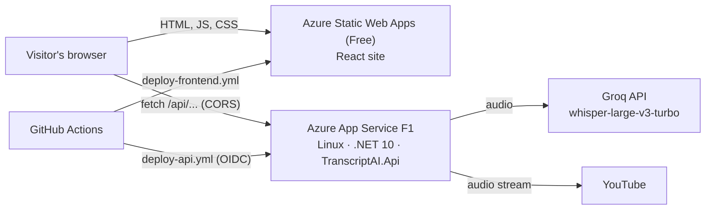

# Deploying the portfolio to Azure (free tier)

This guide puts the whole portfolio online for **$0/month**:

| Piece | Azure service | Plan | Cost |
| --- | --- | --- | --- |
| React site (`frontend/`) | Azure Static Web Apps | Free | $0 |
| Transcript API (`backend/src/TranscriptAI.Api`) | Azure App Service, Linux, .NET 10 | F1 (Free) | $0 |
| Speech-to-text | Groq API (open-source Whisper models) | Free tier, no card | $0 |
| Build & deploy | GitHub Actions | Free for public repositories (2,000 min/month for private) | $0 |



The site and the API live on different domains because **linking a backend to Static Web Apps needs the paid
Standard plan**. On the Free plan the browser calls the API directly, and the API allows the site's origin through CORS.

Allow about 30–45 minutes the first time. Commands are for **PowerShell**; run them one line at a time.

---

## 0. Before you start

- **Azure account**: <https://azure.microsoft.com/free>. Sign-up asks for a card to verify your identity; nothing in this
  guide is billed.
- **Azure CLI**: <https://aka.ms/installazurecliwindows>. If it's already installed, update it with `az upgrade`.
- **GitHub**: admin access to this repository (Settings → Secrets and variables → Actions).
- The repository already contains everything the cloud needs:
  - `.github/workflows/deploy-api.yml` — tests, publishes and deploys the API.
  - `.github/workflows/deploy-frontend.yml` — builds the site and uploads it.
  - `frontend/public/staticwebapp.config.json` — lets deep links such as `/projects` load the React app.

Both deploy workflows **skip themselves** until the settings below exist, so nothing fails in the meantime.

## 1. Get a free Groq API key

1. Sign in at <https://console.groq.com>.
2. Open **API Keys → Create API Key**, name it `portfolio-demo`, and copy the key (it starts with `gsk_`).
   You can't view it again later.

Free-tier limits for the Whisper models: 25 MB per file, 20 requests/minute, 2,000 requests/day and 28,800 seconds
(8 hours) of audio per day. When they're exceeded, Groq answers HTTP 429 and the demo shows a "try again later" message.

## 2. Create the API on App Service (F1, Linux)

```powershell
az login

# Choose names once. The app name must be globally unique: it becomes https://<app>.azurewebsites.net
$rg       = "rg-portfolio"
$location = "centralindia"
$plan     = "plan-portfolio"
$app      = "hari-transcriptai-api"

az group create --name $rg --location $location
az appservice plan create --resource-group $rg --name $plan --is-linux --sku F1
az webapp create --resource-group $rg --plan $plan --name $app --runtime "DOTNETCORE:10.0"
az webapp update --resource-group $rg --name $app --https-only true
az webapp config set --resource-group $rg --name $app --ftps-state Disabled

# The Groq key lives only in App Service settings (encrypted at rest), never in the repository or the browser.
az webapp config appsettings set --resource-group $rg --name $app --settings "Transcription__Groq__ApiKey=<paste your gsk_ key>"

$apiHost = az webapp show --resource-group $rg --name $app --query defaultHostName --output tsv
"API URL: https://$apiHost"
```

Notes:

- Write the runtime as `DOTNETCORE:10.0` (colon). The `DOTNETCORE|10.0` form breaks in Windows shells.
  `az webapp list-runtimes --os linux` lists the available versions.
- If the F1 plan can't be created (a quota or availability error), try another region such as `southindia` or
  `eastasia`.
- Opening the URL now shows Azure's placeholder page; the API arrives in the next step.

## 3. Let GitHub Actions deploy the API

The workflow signs in to Azure with **OpenID Connect**: GitHub proves its identity to Azure with a short-lived token,
so no password or publish profile is stored anywhere. A *user-assigned managed identity* receives that sign-in and
may deploy only to this one web app.

```powershell
$identity = "id-portfolio-github"
az identity create --resource-group $rg --name $identity
$clientId    = az identity show --resource-group $rg --name $identity --query clientId --output tsv
$principalId = az identity show --resource-group $rg --name $identity --query principalId --output tsv

# Trust GitHub Actions runs on the main branch of this repository (case-sensitive).
az identity federated-credential create --resource-group $rg --identity-name $identity --name github-main --issuer "https://token.actions.githubusercontent.com" --subject "repo:Harisundar25/portfolio:ref:refs/heads/main" --audiences "api://AzureADTokenExchange"

# Allow that identity to deploy to the web app, and nothing else.
$webAppId = az webapp show --resource-group $rg --name $app --query id --output tsv
az role assignment create --assignee-object-id $principalId --assignee-principal-type ServicePrincipal --role "Website Contributor" --scope $webAppId

# Values for GitHub:
"AZURE_CLIENT_ID       = $clientId"
"AZURE_TENANT_ID       = $(az account show --query tenantId --output tsv)"
"AZURE_SUBSCRIPTION_ID = $(az account show --query id --output tsv)"
"AZURE_WEBAPP_NAME     = $app"
"API_BASE_URL          = https://$apiHost"
```

In GitHub, open **Settings → Secrets and variables → Actions**:

| Tab | Name | Value |
| --- | --- | --- |
| Secrets | `AZURE_CLIENT_ID` | from the output above |
| Secrets | `AZURE_TENANT_ID` | from the output above |
| Secrets | `AZURE_SUBSCRIPTION_ID` | from the output above |
| Variables | `AZURE_WEBAPP_NAME` | the app name, e.g. `hari-transcriptai-api` |
| Variables | `API_BASE_URL` | `https://<app>.azurewebsites.net` (no trailing slash) |

Then deploy: **Actions → Deploy API (Azure App Service) → Run workflow**. The job runs the test suite, publishes the
API, deploys it and waits until `/api/health` answers. A new role assignment can take a minute or two to apply, so
re-run the job if the first sign-in fails.

Check it yourself:

```powershell
Invoke-RestMethod "https://$apiHost/api/health"
```

Expect `status: ok` and `providerConfigured: True`. After this, every push to `main` that changes `backend/` deploys
automatically.

> **Prefer a publish profile?** It works, but App Service now turns basic-auth publishing credentials off by default, so you
> would have to turn them back on (`az webapp update --resource-group $rg --name $app --basic-auth Enabled`, plus the app
> setting `WEBSITE_WEBDEPLOY_USE_SCM=true` on Linux) and store the downloaded profile as a secret. OIDC avoids both.

## 4. Publish the site on Static Web Apps

```powershell
$site = "swa-hari-portfolio"
# Static Web Apps offers only a few regions for its metadata (eastasia is the closest to India);
# visitors are served from a global edge network either way.
az staticwebapp create --resource-group $rg --name $site --location eastasia --sku Free
$siteHost = az staticwebapp show --resource-group $rg --name $site --query defaultHostname --output tsv
"Site URL: https://$siteHost"

# Deployment token for GitHub (treat it like a password).
az staticwebapp secrets list --resource-group $rg --name $site --query properties.apiKey --output tsv

# Let the site call the API (exact origin: https, no trailing slash).
az webapp config appsettings set --resource-group $rg --name $app --settings "Cors__AllowedOrigins__0=https://$siteHost"
```

In GitHub, add the secret **`AZURE_STATIC_WEB_APPS_API_TOKEN`** with the token printed above. Then run
**Actions → Deploy frontend (Azure Static Web Apps) → Run workflow**.

The workflow builds the site with `VITE_API_BASE_URL` set from the `API_BASE_URL` variable, so the **Live demo** button
appears. Without that variable the build simply hides the demo. Vite fixes `VITE_*` values at build time: **re-run this
workflow whenever `API_BASE_URL` changes**.

> Creating the Static Web App in the portal instead? Pick **Other** as the deployment source. Choosing GitHub there makes
> Azure commit its own workflow file, which would deploy the site twice.

**Optional: contact form.** To send messages through EmailJS rather than opening the visitor's mail app, add the repository
*variables* `EMAILJS_SERVICE_ID`, `EMAILJS_TEMPLATE_ID` and `EMAILJS_PUBLIC_KEY` (all three are public by design), then
re-run the workflow.

## 5. Check everything end to end

1. Open `https://<site>.azurestaticapps.net`, then `https://<site>.azurestaticapps.net/projects` directly: deep links
   must load too.
2. On **Projects**, press **Live demo** on the AI Transcript Generator card. The first visit after a quiet spell shows
   "Waking up the demo server…", because Free apps sleep after 20 idle minutes and take a few seconds to start.
3. Use **Try a 19-second sample** and **Generate transcript**, then try uploading a short MP3.

YouTube blocks many cloud data-center IP ranges, so links can fail on Azure with *"YouTube refused to serve this
video…"* even though they work locally. Uploads aren't affected. To hide the YouTube tab, set
`az webapp config appsettings set --resource-group $rg --name $app --settings "Demo__AllowYouTube=false"`.

## 6. Optional: custom domain

Static Web Apps Free includes two custom domains with free TLS certificates:

1. Portal → your Static Web App → **Custom domains → Add**, and follow the DNS instructions.
2. Add the new origin to the API as a second entry:
   `az webapp config appsettings set --resource-group $rg --name $app --settings "Cors__AllowedOrigins__1=https://www.your-domain.com"`

App Service F1 itself can't use custom domains; the API keeps its `azurewebsites.net` address, which visitors never see.

## Free-tier limits and the demo's guard rails

| Service | Limit | What happens when it's hit |
| --- | --- | --- |
| App Service F1 | 60 CPU minutes/day, 1 GB RAM, 1 GB storage, **165 MB outbound data/day**, sleeps after 20 idle minutes | The app is stopped (HTTP 403) until the quota resets |
| Static Web Apps Free | 100 GB bandwidth/month, 250 MB per app | No overage on Free — far beyond what a portfolio uses |
| Groq free tier | 25 MB/file, 20 req/min, 2,000 req/day, 28,800 audio-seconds/day | HTTP 429 with a retry time, shown to the visitor |

Every audio file the API forwards to Groq counts toward F1's 165 MB/day outbound quota. That is why the API's defaults
in `backend/src/TranscriptAI.Api/appsettings.json` are conservative. Change them as App Service settings, no
redeploy needed:

| Setting | Default | Meaning |
| --- | --- | --- |
| `Demo__MaxUploadMegabytes` | `10` | Largest file a visitor can upload |
| `Demo__MaxDurationMinutes` | `15` | Longest YouTube video accepted |
| `Demo__PermitLimitPerWindow` / `Demo__WindowMinutes` | `5` / `10` | Requests per visitor IP per window |
| `Demo__MaxConcurrentJobs` | `2` | Transcriptions running at once (as many again can queue) |
| `Demo__DailyLimit` | `40` | Transcriptions started per UTC day, across all visitors |
| `Demo__AllowYouTube` | `true` | Show or hide the YouTube option |

**Avoiding surprise bills.** Free plans cannot charge you, but scaling up later would. Add a budget alert:
Portal → **Cost Management → Budgets → Add**, amount `$1`, email alert at 80%.

## Why App Service, and when to move on

The API is an ordinary ASP.NET Core app: a minimal API plus middleware for rate limiting, CORS and problem details.
App Service runs it unchanged and F1 is free. Azure Functions would mean restructuring it around function triggers for
little gain at this size. If the Free tier gets too tight:

- **App Service B1 (Linux)**: about US$10–15/month depending on region. No daily CPU or bandwidth quotas, Always On (no
  cold starts) and custom domains. Run `az appservice plan update --resource-group $rg --name $plan --sku B1`, then raise
  the `Demo__*` limits.
- **Azure Container Apps (Consumption)**: a free monthly grant of 180,000 vCPU-seconds, 360,000 GiB-seconds and
  2 million requests, scaling to zero when idle. It needs a container image, which could also include FFmpeg to allow
  longer recordings and more formats.

## Troubleshooting

| Symptom | Likely cause and fix |
| --- | --- |
| Deploy API workflow shows *skipped* | The `AZURE_WEBAPP_NAME` repository **variable** (not secret) is missing. |
| `azure/login` fails with *No matching federated identity record found* | The federated credential's subject must match exactly: `repo:Harisundar25/portfolio:ref:refs/heads/main` (case-sensitive). |
| Deploy fails with *AuthorizationFailed* | The role assignment hasn't applied yet; wait two minutes and re-run. |
| Demo button missing on the live site | `API_BASE_URL` was empty when the site was built. Set it and re-run *Deploy frontend*. |
| Demo says *offline* | The API URL is wrong or the app is stopped or over quota. Open `https://<app>.azurewebsites.net/api/health` directly. |
| Browser console shows a CORS error | `Cors__AllowedOrigins__0` must equal the site's origin exactly: `https://`, no trailing slash. |
| Demo says the AI provider *isn't configured* | `Transcription__Groq__ApiKey` is missing or mistyped in the App Service settings. |
| HTTP 403 *Site Disabled* from the API | F1's daily CPU or outbound quota is used up; it resets within 24 hours. Lower the `Demo__*` limits or move to B1. |
| `/projects` returns 404 on the site | `staticwebapp.config.json` didn't reach the output; it must be in `frontend/public/`. |

Logs: `az webapp log config --resource-group $rg --name $app --docker-container-logging filesystem`, then
`az webapp log tail --resource-group $rg --name $app`.

**Rotating the Groq key:** create a new key, update `Transcription__Groq__ApiKey`, then delete the old key in the Groq
console. The app restarts by itself when settings change.

**Removing everything:** `az group delete --name $rg` deletes the API, the site and the identity in one go.
